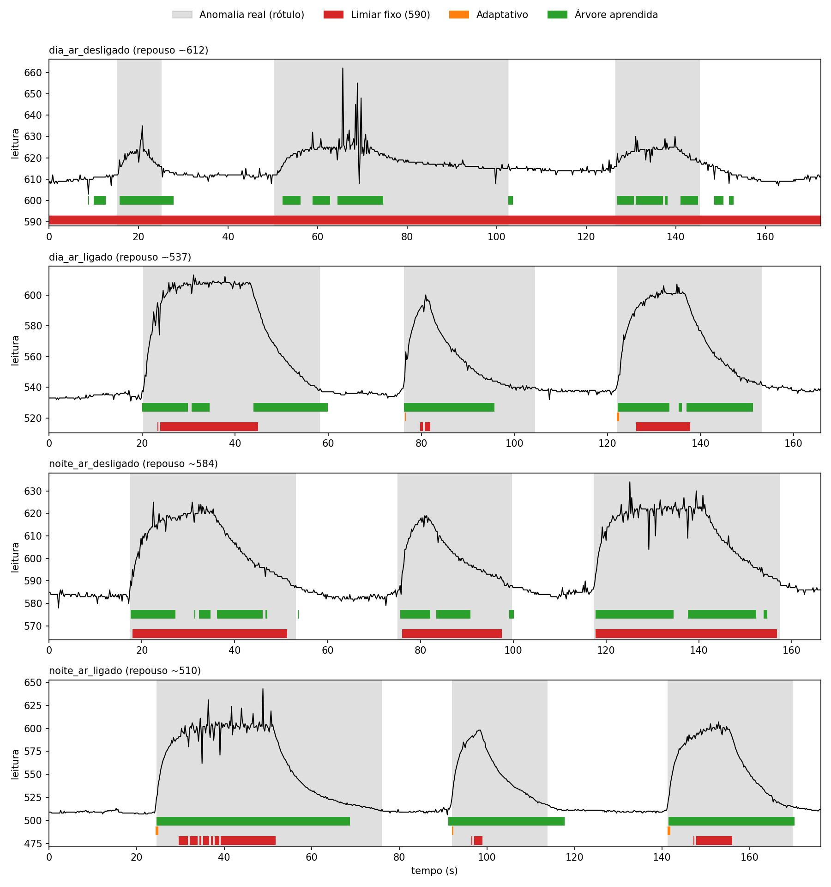

# Sentinela Energético — v2 (classificador aprendido dos dados)

Nó embarcado (Arduino Uno) que lê um sensor, processa tudo localmente e detecta sozinho quando o comportamento sai do normal, acionando LED e buzzer. A v2 troca o limiar fixo por um classificador treinado com dados reais e compara os dois nos mesmos dados.

**Autor:** Wesley (Engenharia Elétrica, UEA)

A versão anterior (limiar estatístico, simulação no PC e Arduino) está preservada na tag `v1-limiar`.

## Resultado em uma tabela

Teste "uma sessão de fora": o modelo é treinado com 3 sessões e avaliado na 4ª, que ele nunca viu, repetindo para cada sessão. A nota é a média entre acertar as anomalias e acertar o que é normal (0,50 equivale a chute).

| Método | Acerta as anomalias | Alarme falso | Nota |
|---|---|---|---|
| Limiar fixo (590) | 64% | 30% | 0,67 |
| Adaptativo (3 desvios) | 2% | 1% | 0,51 |
| Árvore com valores absolutos | 87% | 33% | 0,77 |
| **Classificador aprendido (embarcado)** | **74%** | **6%** | **0,84** |
| Controle: regra "desvio padrão > 1,6" | 77% | 7% | 0,85 |

Nota por sessão:

| Método | dia, sem ar (~611) | dia, com ar (~536) | noite, sem ar (~584) | noite, com ar (~510) |
|---|---|---|---|---|
| Limiar fixo | 0,50 | 0,68 | 0,97 | 0,66 |
| Adaptativo | 0,50 | 0,51 | 0,50 | 0,51 |
| Árvore absoluta | 0,50 | 0,87 | 0,90 | 0,93 |
| Classificador aprendido | 0,71 | 0,87 | 0,85 | 0,93 |



Cinza: período de anomalia real. Barras: o que cada detector marcou. Repare nos buracos da barra verde quando o sinal fica estável no alto (platô): o classificador enxerga mudança, não nível.

## O que o projeto mostra

- **O limiar fixo depende do repouso.** O mesmo 590 marcou anomalia o tempo todo na tarde quente (repouso ~611), funcionou bem na noite sem ar (repouso ~584, só 5 pontos abaixo do limiar) e pegou uma fração nas sessões com ar. O repouso do sensor variou de ~510 a ~611 conforme a temperatura do quarto.
- **O classificador usa a variação, não o nível.** Por isso funcionou com um repouso que nunca viu (483, em teste na placa).
- **O modelo aprendido se reduziu a um corte só:** desvio padrão da janela acima de ~1,75. Árvores mais profundas acertaram um pouco mais, mas dobraram os alarmes falsos, e a regra manual de uma linha empata com o modelo (0,85 contra 0,84). O valor do corte, porém, veio dos dados.
- **O detector adaptativo falha como detector de evento:** percebe o começo e depois se acostuma com a anomalia.

## Como funciona

A cada 200 ms, o sensor é lido e entra em uma janela deslizante de 20 amostras. Dois detectores rodam lado a lado, cada um com sua máquina de estados (NORMAL e ANOMALIA, com histerese de 3 leituras):

1. **Limiar fixo (v1):** leitura acima de 590.
2. **Classificador (v2):** `classifier_predict(stddev)`, código C gerado por `tools/export_tree.py` a partir da árvore treinada.

O LED e o buzzer seguem o classificador, ou o limiar se for trocado com o comando `M`. O classificador tem uma trava anti-pisca: o alarme só termina depois de ~10 s sem variação, e a saída é ignorada por ~5 s depois de mudar.

## Dados e rótulos

Quatro sessões gravadas no próprio sensor (NTC 10 kΩ), em quatro condições: dia e noite, com e sem ar-condicionado. Cada sessão tem 3 aquecimentos do sensor com o dedo (de ~5 a ~27 s), com o sensor parado, sem tocar nas perninhas. São 3413 linhas, das quais 3333 foram usadas (as 20 primeiras de cada sessão, com a janela ainda vazia, são descartadas).

O rótulo de anomalia vai do início do aquecimento até a leitura voltar a ~4 pontos do repouso anterior. Quando o fim do rótulo foi marcado tarde, uma regra no código encurta o bloco (uma única regra, igual para todas as sessões). Os arquivos estão em `data/`.

## Resultados na placa

- Acende ~1 s depois de começar o aquecimento.
- Apaga ~15 a 17 s depois de soltar (medido antes da trava anti-pisca; a versão final espera ~10 s sem variação antes de apagar, e esse tempo não foi medido).
- Memória no Uno: ~9,5 KB de flash (29%) e 758 bytes de RAM (37%), medidos antes da trava anti-pisca.

## Limitações

- **Poucos dados:** um sensor, uma pessoa, 4 sessões e 12 aquecimentos. Os números são indicativos, não conclusivos.
- **A anomalia é calor do dedo no sensor**, usado como substituto de um evento de consumo. O NTC mede temperatura, não corrente.
- **O classificador detecta mudança, não nível:** um platô alto e estável pode passar despercebido depois que a janela se acostuma (recall de 74%).
- **O caso mais difícil é a tarde quente (nota 0,71):** o dedo mal esquenta um sensor que já está quase na temperatura da pele.
- **Pisca-pisca na descida:** durante a descida o classificador chegou a alternar de estado. A trava anti-pisca resolveu nos testes, mas a causa (variação real do sinal ou interferência da saída) não foi isolada.
- **A temperatura em °C é uma estimativa** (assume NTC 10 kΩ, beta 3950).
- O limiar de 590 foi calibrado à mão em uma condição específica.
- O núcleo do código existe em duas cópias (PC e Arduino).

## Como reproduzir

```
python tools\capture_serial.py      # grava uma sessão (comandos A, N, Q)
python tools\load_data.py           # confere os dados
python tools\train_eval.py          # treina e compara (teste por sessão)
python tools\depth_sweep.py         # compara profundidades da árvore
python tools\export_tree.py         # gera classifier.c e classifier.h
python tools\plot_results.py        # gera docs/comparison.png
```

No Arduino, abra `platform/arduino/sentinela_arduino/sentinela_arduino.ino`. Comandos no Serial Monitor (9600): `E` estados, `T` temperatura, `M` trocar o detector que comanda o LED, `L` log CSV, `A` e `N` rótulos.

## Próximos passos

Mais sessões e outros tipos de anomalia, sensor de corrente real em vez do NTC e uma versão para ESP32.